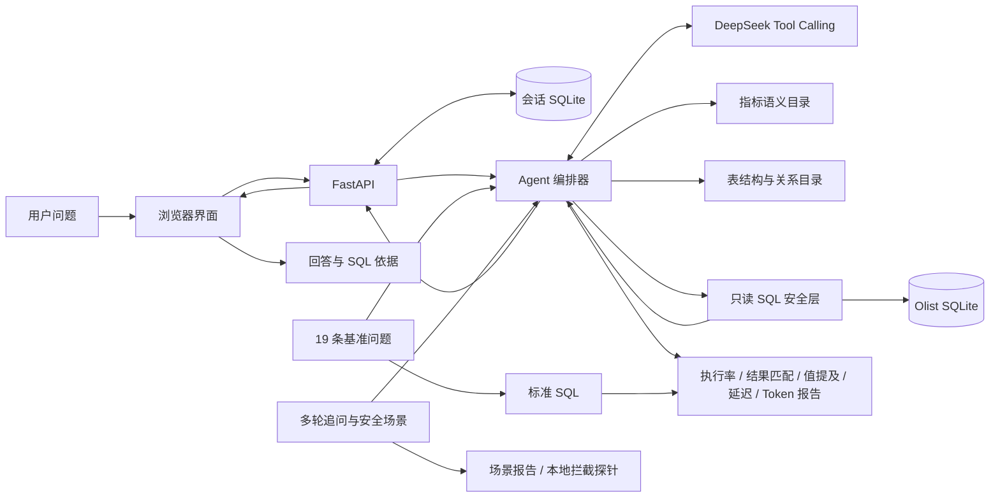

# Agent 架构

## 一次分析请求

1. 浏览器提交问题和可选的 session_id。
2. FastAPI 读取最近 8 条对话，传给 Agent。
3. Agent 根据问题选择业务指标、表结构和 SQL 工具。
4. SQL 安全层检查只读约束，限制执行时间和结果行数，再查询业务数据库。
5. 查询结果和工具调用记录回到 Agent，Agent 给出回答。
6. FastAPI 保存问答，并把回答和本次 SQL 轨迹返回浏览器。

分析数据文件与会话文件分开保存，Agent 只能使用只读数据库连接访问 Olist 表。
